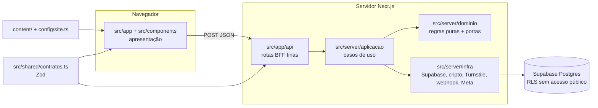
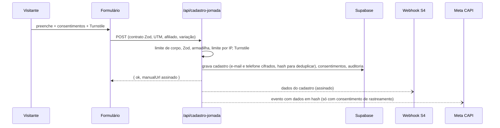

# Plano do projeto

Landing page do Gestor Sincero. Briefing completo em `docs/BRIEFING.md`; vocabulário em `CONTEXT.md`; direção visual em `docs/DESIGN.md`.

## Propriedade de pastas

| Terminal | Modelo | Pastas |
|---|---|---|
| Orquestrador | Fable | o restante: raiz (`package.json`, configs, `.env.example`, `AGENTS.md`), `config/`, `content/schema.ts`, `content/index.ts`, `src/shared/`, `scripts/pesado.sh`, `scripts/servidor.sh`, `docs/` (menos COPY e QA) |
| Conteúdo | Opus | `content/**` (menos `schema.ts` e `index.ts`), `docs/COPY.md` |
| Assets | Haiku | `public/**`, `scripts/assets/**` |
| Front-end | Sonnet | `src/app/**` (menos `api/`), `src/components/**`, `src/styles/**` |
| Back-end | Sonnet | `src/server/**`, `src/app/api/**`, `supabase/**`, `next.config.ts` (headers e CSP) |
| Tester | Haiku | `tests/**`, `docs/QA.md` |

Todos acrescentam linhas em `docs/STATUS.md` e `docs/PERGUNTAS_FERRER.md`.

## Camadas

- Apresentação lê texto de `@content` e valores de `@config/site`; nunca tem texto fixo.
- Rotas BFF só fazem: ler corpo, chamar o caso de uso, devolver `RespostaFormulario`.
- Domínio não importa Next nem Supabase. Infra implementa as portas (repositório, cifra, antirrobô, limite, notificação).

## Fluxo do cadastro

## Decisões fechadas

1. Uma página estática (`/`) mais `/privacidade` e `/termos`. Variação do topo por `?v=a|b` lida no cliente (a página continua estática); padrão A.
2. Consentimentos de WhatsApp e e-mail são opcionais e separados; a ciência do aviso de privacidade é obrigatória. Mensagem de marketing só com consentimento; o link do manual aparece na própria tela de sucesso.
3. Deduplicação por HMAC-SHA256 (pimenta no `.env`) de e-mail e de WhatsApp; cadastro repetido atualiza o registro e devolve sucesso (sem revelar que já existia).
4. Limite por IP em tabela do Postgres (função SQL atômica), sem serviço extra pago. IP guardado só em hash.
5. Exportação CSV: `GET /api/admin/exportar?tipo=cadastros|ressonancia` com JWT do Supabase Auth no header e `app_metadata.papel = "admin"`. Sem painel e sem senha própria (o Supabase guarda as senhas com bcrypt).
6. CSP estática com hashes/SRI se o Next 16 permitir em página estática; senão, registrar o limite em `docs/adr/`. Ver ADR 0001 para a ofuscação.
7. Sem banco provisionado: o Back-end testa com adaptadores em memória atrás das portas; a migração SQL fica pronta em `supabase/migrations/`.

## Ondas (uma por vez; no máximo 2 executores vivos; regras R1 a R8 no `AGENTS.md`)

| Onda | Terminal A | Terminal B | Servidor | Estado em 15/11 |
|---|---|---|---|---|
| 1 | Conteúdo: copy completo em `content/` + `docs/COPY.md` | Assets: recorte do retrato, slides 4/6/17/20 com selo, imagem de compartilhamento, favicon | nenhum | parcial: `content/pagina.ts` existe sem `docs/COPY.md`; `public/img` só com retrato e prêmio |
| 2 | Front-end (dono do servidor): seções 03 a 16, globais no layout | Back-end: adaptadores reais, CSV admin, ligação na composição | dev, um só | parcial: seções 00 a 02 e globais prontos; núcleo, cripto, migração e CSP prontos |
| 3 | Tester: Playwright, axe, Lighthouse, varreduras, prints | (vazio) | prod (build + start, pelo orquestrador) | não iniciada |
| 4 | Correções, um executor por vez | (vazio) | conforme o reteste | não iniciada |

Fim de cada onda: relatórios, commits, `scripts/servidor.sh parar`, sessões encerradas, conferência de sobras (R5) e `free -m` (R6) antes da próxima.

## Pendências de ambiente (Felipe)

- Projeto Supabase e chaves; conta/CLI da Vercel para a prévia; chaves do Turnstile; `snyk`/Socket CLI não instalados (usamos `npm audit`).
