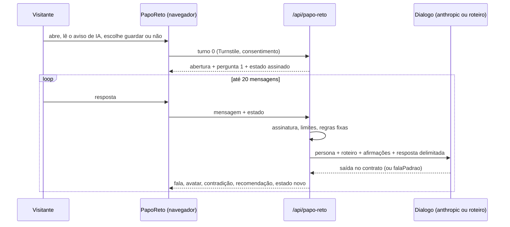

# ADR 0003: Papo reto com o Gestor Sincero

Data: 16/11/2026. Estado: aceito, em teste (sem chave paga).

## Contexto

Conversa em texto com o personagem do Ferrér: 6 a 8 perguntas, aponta contradições e termina com uma recomendação (Jornada, Ressonância ou Mentoria). Não substitui o formulário da Jornada.

## Decisões

1. **Uma rota BFF, sem estado no servidor.** `POST /api/papo-reto` recebe a mensagem e um `estado` assinado por HMAC (afirmações, pergunta atual, contagem). O servidor valida a assinatura, gera o turno e devolve o estado novo. Limite de 20 mensagens sai da contagem assinada; sem sessão em banco. Troca: o estado trafega pelo navegador, então nunca carrega nada além do que o próprio visitante disse.
2. **Porta `Dialogo` com dois adaptadores.** `anthropic` (uma chamada por turno, modelo em `AI_MODEL_DIALOGO`, timeout de 20 s, teto de tokens) quando há `ANTHROPIC_API_KEY`; `roteiro` (determinístico: segue as perguntas e aplica as regras fixas de contradição) quando não há, só fora de produção. O teste sem custo usa o `roteiro`.
3. **A fala do visitante é dado, nunca instrução.** Vai delimitada na mensagem do usuário; a persona e o roteiro vão no sistema; nenhuma ferramenta exposta. A saída é validada por `saidaDialogoSchema`; fora do contrato vira `falaPadrao`.
4. **Regras fixas além do modelo.** Contradições conhecidas (decide por números × não mede custo por cliente; vendas cresceram × o problema é vender; terceiros cuidam do digital × quer resolver o digital) são conferidas em código sobre as afirmações, com ou sem modelo.
5. **Sem consentimento, nada é salvo.** Com consentimento: tabela `papo_reto` com texto em AES-256-GCM, RLS sem acesso público e limpeza de 30 dias.
6. **Desligado em produção** (`site.papoReto.ativo`) até haver chave, Supabase, Turnstile e a autorização escrita de imagem. Os vídeos em `public/ferrer-avatar/` ficam fora do git e do envio à Vercel até essa autorização.

## Fluxo

## Antes de ligar em produção

Parágrafo na política de privacidade (conversa, Anthropic como operadora, transferência internacional, 30 dias), custo medido por conversa e autorização de imagem arquivada.
